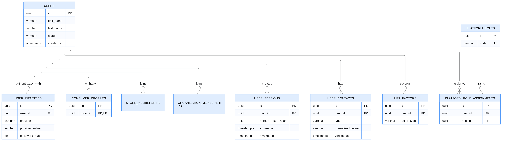
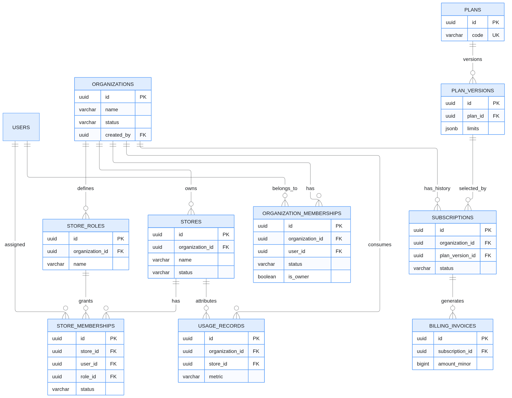
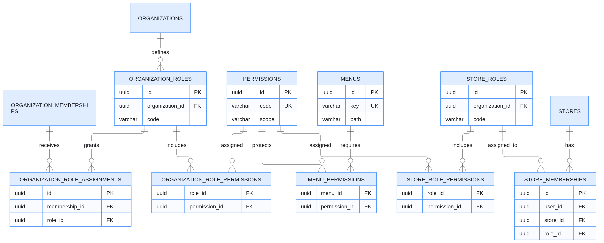
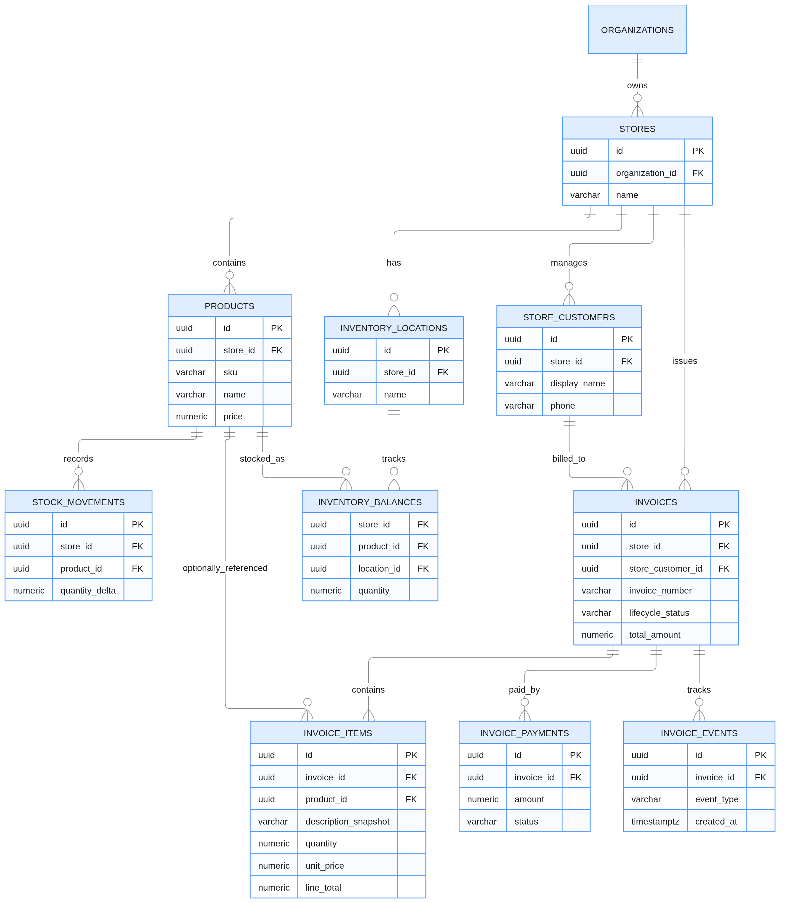
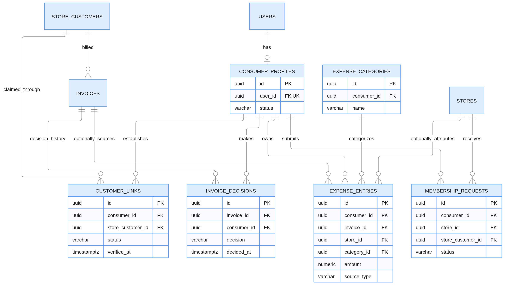

# EGHissab — Complete Database ERD & Identity Lifecycle

Architecture Design · Proposed v1.0

**Technology**: Go + PostgreSQL + Redis + React + Expo

**Architecture**: Modular Monolith · Multi-Tenant · Multi-Organization · Multi-Store

**Scope**: Database entities, primary and foreign keys, relationship cardinality, signup, login, tenant onboarding, store selection, customer registration, offline/online customer linking, invoice authorization, and data isolation.

This design is a proposed target model. It has not been reconciled against your current EGHissab repository or approved ADRs, so it should not trigger schema migrations yet.

## 1. First understand the database relationships
The most important principle is that a user, an organization, a store, and a customer are four different concepts.

A single user can own Organization A, work for Store B, and use the global expense tracker.

Do not create three independent authenti
cation systems or three duplicate user records for this person.

## 2. Master ERD — six connected database domains
The complete database can be understood through six related diagrams:
1. Identity and authentication
2. Organization, subscription and store ownership
3. Roles and permissions
4. Store operations and invoicing
5. Global customer and expense management
6. Events, audit and background processing

These diagrams show the core entities and relationships. The full column specifications follow them.

### Domain A — Identity and authentication

Relationship rules:
- One user → many contacts.
- One user → many authentication identities, such as password or Google.
- One user → many login sessions.
- One user → zero or one consumer profile.
- One user → many organization and store memberships.
- Platform roles are assigned independently of store roles.

For example, logging in with Google after registering by email must link to the same user only through a secure verified identity-linking process.

### Domain B — Organization, subscription and stores

One organization has many stores but every store belongs to exactly one organization.

One user can belong to many organizations through organization_memberships.

A historical subscription can remain in the database after a new subscription is created. Enforce a maximum of one currently effective billing subscription per organization according to the approved billing state model.

The is_owner field above represents a proposed simplification for organization ownership. Ownership transfer, multiple owners, and guaranteed last-owner protection need additional rules.

### Domain C — Role and permission management

Recommended permission examples:

organization.manage, store.create, staff.manage, product.read, product.write, invoice.issue, invoice.void, customer.manage.

Store roles can be reusable within an organization; their memberships remain store-specific. This avoids duplicating identical role definitions unnecessarily.

Important: Menus are presentation metadata. Hiding a menu is not authorization. Every API operation must enforce its own permission and resource checks.
### Domain D — Store operations, customers and invoicing

An invoice belongs to one store, even when the customer also shops in other stores.

A store product can be referenced by an invoice item, but the actual issued invoice item must preserve its own description, price, discount and tax snapshots. Product changes must not rewrite issued invoice history.

Inventory balances should be controlled by transactional stock movements, not arbitrary client-side increments.

## Domain E — Global customers, store membership and expenses
This is a particularly important ERD for EGHissab.

The critical relationship is:

users → consumer_profiles → customer_links → store_customers → invoices

That is how one global customer gets access to invoices originating in multiple isolated stores.

A customer linking request is different from an established customer link. Pending requests must not grant invoice access.

The invoice decision history can contain multiple events if business rules permit reversal or amendment, while the effective decision is derived from the allowed lifecycle.

Expense entries linked to invoices should have a unique source rule preventing the same invoice from being counted twice. A reported personal expense can exist without any store or invoice.

## 3. Complete core table specification
These tables form the recommended relational baseline. All tables should have appropriate timestamps, constraints and indexes even when not repeated below.

Notation: PK = primary key; FK = foreign key; UQ = unique constraint; NULL = optional.
### A. Identity tables

| Table | Primary fields and relationships |
|------|--------------------------------|
|users|id PK, first_name, last_name, status, created_at, updated_at|
|user_contacts|id PK, user_id FK, type, normalized_value, verified_at, is_primary|
|user_identities|id PK, user_id FK, provider, provider_subject, password_hash|
|user_sessions|id PK, user_id FK, refresh_token_hash, expires_at, revoked_at, token_family_id|
|mfa_factors|id PK, user_id FK, factor_type, encrypted_secret, status|
|verification_challenges|id PK, user_id nullable, contact_id nullable, challenge_hash, purpose, expires_at, consumed_at|
|platform_roles|id PK, code UQ, name|
|platform_role_assignments|id PK, user_id FK, role_id FK, assigned_by, revoked_at|
|consumer_profiles|id PK, user_id FK UQ, status, preferences|

Credentials must use strong, purpose-appropriate password hashing. Verification secrets and refresh credentials are stored as hashes or appropriately protected secrets, not plaintext.

### B. Organization and billing tables

| Table | Primary fields and relationships |
|------|--------------------------------|
|organizations|id PK, name, slug, status, created_by|
|organization_memberships|id PK, organization_id FK, user_id FK, status, is_owner|
|organization_roles|id PK, organization_id FK, code, name|
|organization_role_assignments|id PK, membership_id FK, role_id FK|
|organization_role_permissions|role_id FK, permission_id FK, composite PK|
|plans|id PK, code, name, status|
|plan_versions|id PK, plan_id FK, version, price, currency, billing_interval, limits|
|subscriptions|id PK, organization_id FK, plan_version_id FK, status, period_start, period_end|
|billing_invoices|id PK, subscription_id FK, amount, currency, status, provider_reference|
|billing_payments|id PK, billing_invoice_id FK, provider, provider_transaction_id, status, amount|
|usage_records|id PK, organization_id FK, store_id nullable, metric, quantity, source_key, recorded_at|
|organization_invitations|id PK, organization_id FK, email, invitation_token_hash, status, expires_at|

Subscription-provider webhook events also need durable, uniquely identified receipt records so retries do not cause duplicate payment or subscription transitions.

### C. Store and authorization tables

| Table | Primary fields and relationships |
|------|--------------------------------|
|stores|id PK, organization_id FK, name, slug, status, created_by|
|store_memberships|id PK, store_id FK, user_id FK, role_id FK, status|
|store_roles|id PK, organization_id FK, code, name, system_role|
|permissions|id PK, code, scope, description|
|store_role_permissions|role_id FK, permission_id FK, composite PK|
|menus|id PK, key, label, route, parent_id, portal|
|menu_permissions|menu_id FK, permission_id FK, composite PK|
|store_invitations|id PK, store_id FK, intended_contact, role_id, token_hash, expires_at|
|store_settings|store_id PK/FK, timezone, currency, invoice_preferences|
For this baseline, one active store membership has exactly one assigned store role. If you later require multiple roles, that would change the schema deliberately.

Store-specific role overrides can be introduced later if organization-reusable roles are insufficient.

### D. Store business tables
| Table | Primary fields and relationships |
|------|--------------------------------|
|products|id PK, store_id FK, sku, name, price, status|
inventory_locations|id PK, store_id FK, name|
inventory_balances|store_id, product_id, location_id, quantity; composite PK|
stock_movements|id PK, store_id, product_id, location_id, quantity_delta, reason, reference_id|
store_customers|id PK, store_id FK, customer_number, display_name, contact details|
invoices|id PK, store_id, store_customer_id, invoice_number, lifecycle_status, totals, currency|
invoice_items|id PK, store_id, invoice_id, product_id nullable, snapshots, quantities, amounts|
invoice_decisions|id PK, invoice_id, consumer_id, decision, decided_at|
invoice_events|id PK, invoice_id, actor_user_id, event_type, metadata, created_at|
invoice_payments|id PK, invoice_id, amount, currency, method, status, external_reference|
invoice_adjustments|id PK, invoice_id, type, amount, reason, created_by|

The invoice_adjustments design must be aligned with tax, credit-note, and accounting requirements. It must not silently rewrite immutable issued invoice data.

### E. Global customer tables
| Table | Primary fields and relationships |
|------|--------------------------------|
|customer_links|id PK, consumer_id, store_customer_id, status, verified_at, access_from
|membership_requests|id PK, consumer_id, store_id, store_customer_id nullable, status, reviewed_by
|expense_categories|id PK, consumer_id, name, parent_id nullable
|expense_entries|id PK, consumer_id, invoice_id nullable, store_id nullable, category_id nullable, amount, currency, source_type
|expense_adjustments|id PK, expense_entry_id, amount_delta, reason, created_at

A verified customer_link establishes identity correspondence. It does not itself settle historical invoice visibility. That must be controlled by access_from, invoice eligibility rules, and any approved sharing restrictions.