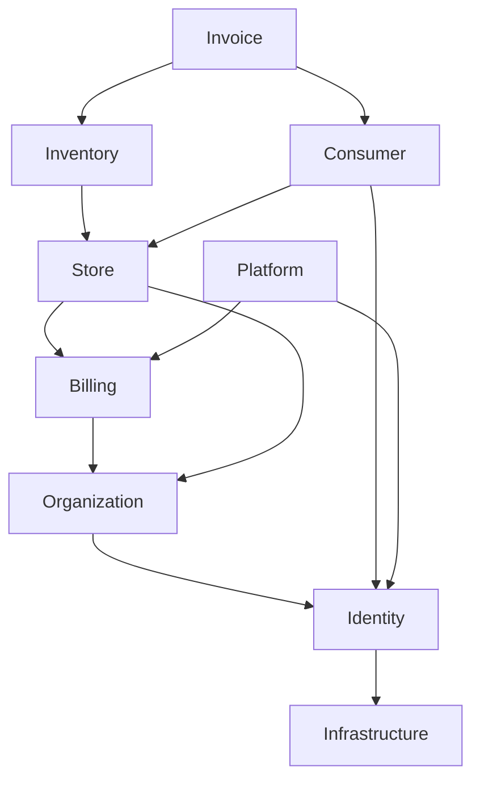

# Dependency map

## 2026-10-22 authentication update

Current wiring adds cmd/api → identity module → service-owned TxManager → identity SQL functions/RLS and injected SMTP mailer. Earlier wiring inventory below is historical.

## Current wiring
`cmd/api` → config/database/request-ID middleware → health and listing. Listing handler → service → repository → DBTX or SQL pool. Legacy handlers/db forward to these implementations. Transaction manager is constructed but unused by services.

## Target dependencies (not implemented)
Arrows mean “depends on”; modules must consume explicit public interfaces.

Consumer invoice reads should use an invoice-owned query interface with approved-link authorization; avoid a consumer↔invoice package cycle. Event/worker adapters depend on published contracts. Frontend/mobile depend on API contracts, never SQL tables. See [boundaries](../02-architecture/module-boundaries.md).

Related: [Documentation index](../README.md).
