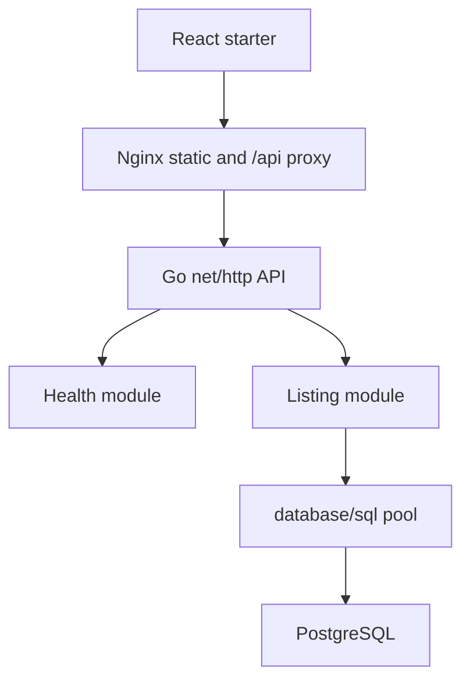

# System architecture

## Actual source topology

Browser API interaction is planned; starter has no business API calls. Compose declares this deployment topology; no containers were started. Evidence: `docker-compose.yml`, `frontend/nginx.conf`, `backend/cmd/api/main.go`.

## Target additions
Shared identity/authentication, organization billing, store isolation, consumer views and module contracts described in [dependency map](../00-ai-context/dependency-map.md). Redis, worker and outbox are proposed, absent. Initial VPS deployment is a cost target, not measured capacity or production readiness.

Related: [Documentation index](../README.md).
