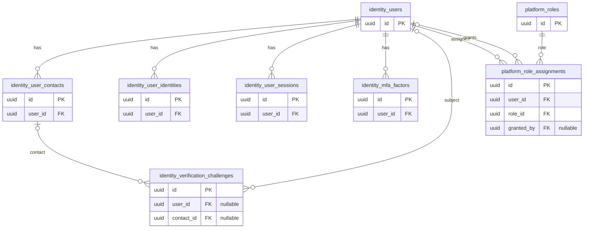

# Actual migration ERD

FACT: eight tables only. Optional FK relationships are shown separately. Columns, constraints and indexes are in [dictionary](schema-dictionary.md). The absent listing relation is intentionally excluded.

Entity names replace schema dots with underscores for display. No target domain relationships are represented as existing tables.

Related: [Documentation index](../README.md).
